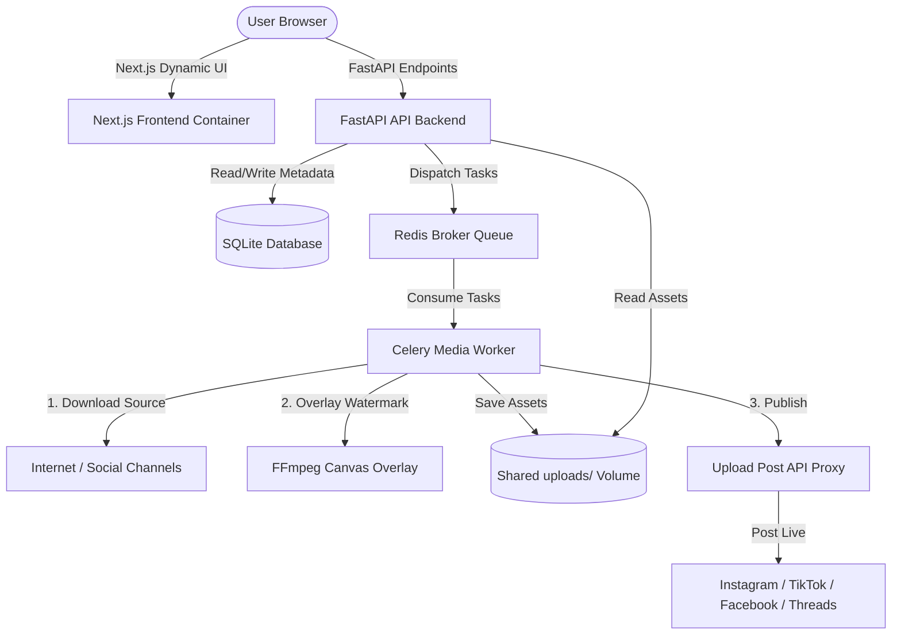

# 🚀 Anigraivity-Poster: Advanced Multi-Platform Campaign Scheduler & Auto-Poster

Anigraivity-Poster is a premium, high-performance, and beautifully designed full-stack MVP application engineered to automate the download, watermarking, and scheduled publication of viral videos across multiple social networks (Instagram, TikTok, Facebook, Threads, and more) using a single, unified workflow dashboard.

Designed with **modern dark-mode glassmorphism aesthetics**, premium Outfit typography, seamless micro-animations, and custom SVG integration, this platform acts as an automated content-engine proxy for the Upload Post API.

---

## 🎨 Design & Aesthetic Highlights

- **Vibrant Glassmorphism Dashboard**: Sleek backdrop blurs, dark slate gradients, and neon lime/emerald accents create a premium, state-of-the-art interface.
- **Foolproof Clickable Triggers**:
  - Entire collection and profile rows are interactive with `cursor-pointer` indicators and dynamic green glows (`border-l-2 border-lime-400 bg-lime-400/5`), completely replacing boring static details buttons.
  - Interactive connected accounts now support outward social profile tab navigation with high-contrast hover feedback and external link symbols.
- **Redesigned Date-Time Picker**: The date and time scheduler field is a high-visibility, full-width click target with custom Lucide Calendar and Clock icons, enabling easy date picking.
- **Interactive Progress & Rendering Indicators**: Pulse animations, spinning loaders, and beautiful dynamic progress bars keep the user fully informed about video rendering and export success rates in real-time.

---

## 🛠️ Technology Stack

### Frontend
- **Next.js 16 (App Router)** & **React** for dynamic, high-performance page loads.
- **Tailwind CSS** for premium responsive styling, gradients, and custom themes.
- **Clerk Auth** for bulletproof high-contrast authentication flows and authorization policies.
- **Lucide Icons** for modern minimalist interface symbols.

### Backend & Queue
- **FastAPI (Python 3.10)** providing high-throughput async endpoints, database schemas, and external API routing.
- **Celery Worker Pool** handles computationally intensive background video processes (yt-dlp, FFmpeg).
- **Redis Server** serving as the task broker and message queue.
- **SQLite Database** storing relational information on profiles, collections, media assets, and scheduled tasks.
- **FFmpeg & yt-dlp** integration for video download, transcoding, and professional canvas overlays.

---

## 📐 System Architecture

The entire system runs fully containerized using Docker Compose:



---

## 📂 Repository Structure

```
├── docker-compose.yml       # Production/Staging multi-container Orchestration
├── nginx.conf               # Nginx Reverse Proxy Server configurations mapped to apeworker.top
├── README.md                # This Documentation
├── .gitignore               # System-wide Git ignore rules
│
├── backend/
│   ├── Dockerfile           # Python & FFmpeg environment builder
│   ├── requirements.txt     # Python Dependencies
│   └── app/
│       ├── main.py          # FastAPI application server, endpoints, and Auth checkers
│       ├── database.py      # SQLite model definitions (SQLAlchemy)
│       └── tasks.py         # Celery background jobs (yt-dlp download, FFmpeg processing, publication)
│
└── frontend/
    ├── package.json         # Node.js configurations and libraries
    ├── next.config.ts       # Next.js compiler parameters
    ├── Dockerfile           # Node.js production compiler
    └── src/app/
        ├── layout.tsx       # Root layout and Clerk configuration
        ├── globals.css      # Core style definitions and custom animations
        ├── accounts/        # Page: Social Profile details and integrations
        ├── collections/     # Page: Catalog files list and rendering details
        ├── schedule/        # Page: Advanced visual date scheduler
        └── videos/          # Page: Video sources list and previews
```

---

## ⚡ Local Development Quickstart

To run the application locally without Docker containers:

### Prerequisites
- Node.js (v18+)
- Python (v3.10+)
- Redis Server running on `localhost:6379`
- FFmpeg installed on your host system

### 1. Backend Setup
```bash
# Navigate to backend
cd backend

# Create virtual environment and activate
python -v venv venv
source venv/bin/activate  # On Windows: venv\Scripts\activate

# Install dependencies
pip install -r requirements.txt

# Create .env file based on example
cp .env.example .env

# Start FastAPI server
uvicorn app.main:app --reload --port 8000

# In a separate terminal, start Celery worker
celery -A app.tasks.celery_app worker --loglevel=info
```

### 2. Frontend Setup
```bash
# Navigate to frontend
cd frontend

# Install Node modules
npm install

# Create env file
cp .env.example .env.local

# Run development server
npm run dev
```
Open **`http://localhost:3000`** to view the app!

---

## 🚢 Production Deployment (Contabo VPS)

Follow these instructions to run the application securely on an Ubuntu/Debian production environment mapped to **`apeworker.top`**.

### 1. Install Docker & Nginx on VPS
```bash
sudo apt update && sudo apt upgrade -y
curl -fsSL https://get.docker.com -o get-docker.sh && sudo sh get-docker.sh
sudo apt install -y docker-compose-plugin nginx
sudo systemctl enable nginx && sudo systemctl start nginx
```

### 2. Configure Environment Files
Clone this repository to `/var/www/apeworker` and verify env settings:
```bash
# Backend .env template
cp backend/.env.example backend/.env

# Frontend .env template
cp frontend/.env.example frontend/.env.local
```
> [!IMPORTANT]
> Verify your `CLERK_SECRET_KEY` and the `UPLOAD_POST_API_KEY` are correct in the environment configurations.

### 3. Launch Services
Start the application in background detached mode:
```bash
sudo docker compose up -d --build
```

### 4. Enable Nginx Reverse Proxy
```bash
# Copy Nginx server configuration
sudo cp nginx.conf /etc/nginx/sites-available/apeworker.top

# Enable site via symlink
sudo ln -s /etc/nginx/sites-available/apeworker.top /etc/nginx/sites-enabled/

# Verify syntax and reload Nginx
sudo nginx -t
sudo systemctl reload nginx
```
The site is now live at **`https://apeworker.top`** (after setting up SSL via Certbot)!

---

## 🛠️ Operations & Maintenance

### Monitor Celery Background Logs
```bash
sudo docker compose logs -f celery_worker
```

### Scale Media Workers for High Workloads
```bash
sudo docker compose up -d --scale celery_worker=3
```

### Backing Up SQLite DB & Media Uploads
```bash
sudo tar -cvf apeworker_backup.tar /var/lib/docker/volumes/apeworker_uploads
```
